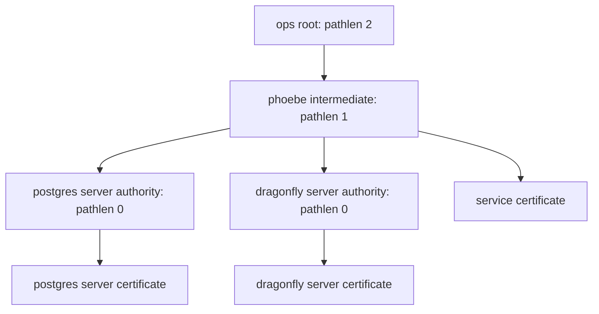

# Phoebe migration to ops

Move the existing Phoebe cluster into `ops` in three stages: transfer repository ownership, adopt shared core, then migrate certificates.
Keep workloads, storage and cluster identity intact throughout the move.
Each stage has its own acceptance criteria and rollback point.

The original plan was reviewed on November 11, 2026.
The current-state section records completed cutovers; the detailed stages below retain the original migration guidance.

## Target structure

Shared core provides common controllers and policies with explicit cluster overrides.
Phoebe keeps its networking, storage and hardware requirements.
Sharing a definition does not require deploying it to every cluster.

| Location | Responsibility |
| --- | --- |
| `kube/deploy/core/` | Shared controllers and policies |
| `kube/deploy/apps/base/` | Reusable application definitions selected by each cluster |
| `kube/deploy/apps/phoebe/` | Phoebe application selection and overrides |
| `kube/clusters/phoebe/` | Flux entry point, cluster identity and Talos configuration |
| `kube/components/` | Reusable database, identity, backup and namespace integration |
| `pki/` | Certificate authority lifecycle and public certificates |

## Current state

Updated November 12, 2026 after the optional shared operator cutovers.

Phoebe reconciles from `ops`, with `kube/deploy/apps/phoebe` as its application
composition layer. It still includes `kubernetes/apps` for unmigrated workloads.
The Flux entry point remains `kubernetes/flux/cluster`.

- Flux operator, Cilium, CoreDNS, metrics-server, External Secrets,
  cert-manager, trust-manager, Kyverno and Kopiur use shared core definitions.
- Reloader, Reflector, snapshot-controller, ksgate and cert-manager CSI now use
  shared core definitions. Their release identities, chart versions and values
  are unchanged. Kopiur depends on `core-snapshot-controller`.
- Core owns the Prometheus CRDs and password ClusterGenerator (`pw`). Controller
  monitoring resources are enabled in core, independently of a monitoring stack.
- CloudNativePG and Barman, Dragonfly, Garage, OpenTelemetry, Envoy Gateway,
  Crossplane, kro, tofu-controller, tuppr and miroir now use optional core
  definitions. Phoebe selects the whole batch; Rhea selects only OpenTelemetry,
  Envoy Gateway and tuppr. Cluster configuration stays separate.
- Phoebe retains 1Password Connect indefinitely and does not select the SDK store.
- The CA and Let's Encrypt cutovers are complete. Database client authorities
  remain service-specific, with shared-root trust and application permissions.
- Network policies use the standard names and labels. Legacy default policies
  are removed; active allowances explicitly disable default-deny.
- `core-kyverno` and `core-kyverno-config` own the existing release and trust
  policy. The HelmRelease UID was retained during transfer.
- Core trust injection applies by default to eligible new pods, mounts
  `/var/run/trusted-roots`, and honours the opt-out and profile annotations.
  Explicit application references use that path. Existing pods are not mutated
  retroactively and can retain their previous injected mounts until replaced.
- Admission tests covered default injection, opt-out, Python profiles on regular
  and init containers, environment preservation and mount collisions.
- Phoebe selects core Kyverno directly; its redundant namespace wrapper is gone.
- Local-network policies live under Phoebe's Cilium directory. Application
  policies deploy alongside their applications.

Kopiur uses `core-kopiur` and `core-kopiur-config`. Phoebe retains its existing
repository, UI/SSO integration and Grafana Operator bindings under its application
directory. The HelmRelease and ClusterRepository identities were retained.

Remaining Phoebe-specific infrastructure,
workloads and operations still need migration out of the compatibility tree.
Do not remove that tree's root include until its retained resources have moved.

## Compatibility requirements

| Area | Required treatment |
| --- | --- |
| Cilium | Preserve BGP, native routing, `bond+`, address pools and Multus integration through Phoebe overrides. |
| Network policies | Migrate existing allowances and labels before changing enforcement. Test both allowed and blocked connections. |
| Secrets | Preserve SOPS decryption and existing keys. Phoebe retains 1Password Connect indefinitely; do not select the shared SDK store. |
| Helm recovery | Preserve Phoebe's `remediateLastFailure: false`. Shared defaults currently set it to `true`. |
| Release identity | Preserve Helm release names, namespaces and storage namespaces during ownership transfer. |
| trust-manager | Preserve existing database Secret bundles. Shared core changes its namespace and omits their current Secret target permissions. |
| Certificates | Preserve public issuers, database client authorities and the certificate CSI driver until replacements pass connection tests. |
| Talos | Preserve the existing cluster secrets. The repositories use different 1Password item layouts and Talos versions. |

Phoebe disables automatic final Helm remediation because a previous rollback downgraded software against newer stored data.
Retain that behavior during migration.

## Migration stages

### 1. Record the baseline

1. Record the source revisions and live Flux inventories.
2. Record Helm release identities, versions, storage claims and certificate consumers.
3. Make sure that backups, recovery credentials and access outside Flux work.
4. Compare rendered repository resources with the live cluster.
5. Record existing failures separately from migration failures.

Acceptance: every managed resource has an identified owner, and recovery access works.

### 2. Prepare a compatible deployment

Import the complete Phoebe deployment into `ops` before changing its layout or shared defaults.
A temporary `kubernetes/` tree preserves paths during the repository transfer.
Keep it separate from the new core selection so that two Flux deployments do not manage the same resources.

1. Copy the application tree and its reusable components with existing resource identities and versions.
2. Preserve SOPS resources, External Secrets dependencies, database authorities and the certificate CSI driver.
3. Preserve nested paths, including component references and the Tailscale Terraform source path.
4. Carry repository authentication, webhook configuration and status reporting into the transfer plan.
5. Add schema validation and rendering checks to CI.
6. Compare the rendered resource inventory and values with the baseline.

Acceptance: the candidate tree contains the complete existing deployment with only reviewed repository reference changes.

### 3. Transfer Flux ownership

Do not use the general bootstrap task for this transfer.
Its Talos branch applies machine configuration with automatic bootstrap enabled.

1. Record the old Flux source URL, revision, path and authentication reference.
2. Stop competing reconciliation before changing ownership.
3. Disable pruning on affected owners and protect resources before removing or renaming their Flux owners.
4. Reconcile those protections before changing source paths or inventories.
5. Point the existing Flux instance at the complete compatibility tree in `ops`.
6. Resume reconciliation in dependency order.
7. Make sure that workloads, routes, storage and certificate renewal remain healthy.
8. Restore pruning only after the new inventory accounts for every retained resource.

Protect both parent and child inventories where ownership changes.
Suspending a parent does not suspend its child Flux Kustomizations, the resources that define separate reconciliation loops.
Avoid deleting HelmRelease objects during handover because deletion can uninstall their releases.
Follow the [Flux resource move guidance](https://fluxcd.io/flux/faq/#how-can-i-safely-move-resources-from-one-dir-to-another).

Acceptance: the existing deployment reconciles from `ops` without unintended resource replacement or deletion.

Rollback: stop the new reconciliation, restore the recorded source and ownership configuration, then resume the old deployment.
Keep pruning protections until the restored inventory is complete.

### 4. Adopt shared core

1. Replace one duplicated controller definition at a time.
2. Preserve Helm release identities while updating Flux names and dependency references.
3. Move Cilium together with its Phoebe overrides and routing resources.
4. Preserve existing database trust bundles when adopting shared trust-manager.
5. Preserve Phoebe's 1Password Connect server and existing ClusterSecretStore. The shared SDK provider is not part of Phoebe's migration.
6. Render both Phoebe and Rhea after shared changes.
7. Remove each compatibility definition only after its new owner passes acceptance tests.

Acceptance: shared core manages Phoebe with working DNS, routing, secrets, storage and controllers.
Rhea still renders successfully with its own overrides.

Rollback: restore the previous owner and values for the affected controller.
Keep chart upgrades and changes to stored data formats outside this stage.

### 5. Migrate certificate trust

A certificate authority signs certificates that other systems can trust.
The accepted hierarchy retains Phoebe's database server authorities:

Path length limits the number of subordinate authorities, excluding the final service certificate.
The public root and cluster certificates now contain the required limits.
Database authorities still need explicit constraints, issuance and a complete chain test.
See [RFC 5280](https://www.rfc-editor.org/rfc/rfc5280#section-4.2.1.9) for path length semantics.

Keep PostgreSQL, Dragonfly and dfguard client authorities separate during this migration.
Their certificates grant client access and are distinct from server identity.
Keep Talos authorities in the existing TOPF secrets workflow.

1. Make sure that the 1Password authority matches the committed certificate and contains its matching private key.
2. Test the secret store, authority Secret and issuer readiness before changing certificate consumers.
3. Distribute both the existing Phoebe root and the new ops root before switching issuance.
4. Preserve existing bundle names and database Secret targets while their consumers remain active.
5. Stage Kyverno trust injection for a small application group.
6. Make sure that the bundle exists in each selected namespace before recreating its pods.
7. Renew database authorities and server certificates in controlled batches after the issuer change.
8. Test complete chains, database connections and application reloads after each batch.
9. Deploy certificate expiry alerts and test notification delivery.
10. Remove old roots and authorities only after every dependent consumer finishes migration.

The old and new issuers share the name `cluster-ca`.
Changing its Secret changes the signing authority but does not automatically renew all existing certificates.
See the [cert-manager CA issuer limitations](https://cert-manager.io/docs/configuration/ca/).
Keep the previous issuer Secret and old trust available for rollback during the transition.

Kyverno reads annotations on pod templates and mutates newly created pods only.
Use the [trust profiles](../standards/pki.md) for application-specific certificate loading.
Existing environment variables, excluded namespaces and volume collisions can prevent automatic adoption.

Acceptance: migrated clients accept the new chains, database authentication still works, and expiry alerts reach their destination.

Rollback: restore the old signing source and affected certificates as needed, while keeping both roots trusted.
A Git revert alone does not restore certificates already issued or trust already removed.

### 6. Move remaining operations

1. Compare generated Talos configuration against the existing cluster before applying it from `ops`.
2. Reuse the existing Talos identity and keys when adapting the 1Password item layout.
3. Move Terraform without changing state locations or resource addresses.
4. Move VPS Compose, Ansible and operational documentation.
5. Update remaining automation, repository references and ownership rules.
6. Archive `phoebe` only after every operational responsibility moves.

Acceptance: `ops` governs cluster and external infrastructure, and no active workflow depends on the old repository.

## First implementation milestone

Prepare the complete compatibility tree and its rendered comparison before scheduling the ownership transfer.
The corrected certificate hierarchy removes the need to flatten database server authorities.
It does not replace the ownership, trust distribution or certificate renewal stages.

The PKI workflow tests still expect the old path lengths of `1` and `0`.
Update those assertions and add a database authority chain test before relying on that suite for the new hierarchy.
